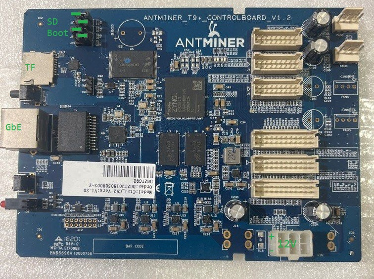

# Antminer T9+ / S9 Control Board as a Turnkey PYNQ Devboard

Transform surplus **Bitmain Antminer T9+** (Ctrl_C92 V1.2) and **S9** control boards into full-featured **Xilinx Zynq-7000 (XC7Z010)** development boards running **PYNQ 3.0.1 (Ubuntu 22.04 LTS armhf)** and **Linux 6.6.0-xilinx**.

Enjoy dual-core ARM Cortex-A9 @ 667 MHz, 1 GB DDR3 RAM, Gigabit Ethernet, and 9x 3.3V expansion headers (Banks 34 & 35) on a **$10–$15 surplus board** — completely **zero-touch**: flash with Balena Etcher, copy files, flip JP4, and boot straight into Jupyter and SSH.



---

## Start Here: Original Project vs. Why Use This Repo

### 1. Try the Original `opensatellite/antminer_t9` First
We recommend checking out the original [opensatellite/antminer_t9](https://github.com/opensatellite/antminer_t9) repository first. It was the pioneering open-source effort to turn Antminer T9 boards into Zynq devboards and established many of the fundamental pinout tables and Vivado configurations used here.

If your board boots cleanly following the instructions in `opensatellite/antminer_t9`, you are all set!

### 2. Why Use This Repository?
Many users running **Antminer T9+ (Ctrl_C92 V1.2)** and **S9** boards encounter two major roadblocks with earlier methods:

1. **`BOOT.BIN` Boot Failure (Silent Hang):** The custom-compiled `BOOT.BIN` provided in `opensatellite/antminer_t9` does not reliably initialize the specific DDR3 trace delay timings and MIO pinmux matrix on newer T9+ / S9 revisions. On these boards, the CPU hangs immediately in the First Stage Bootloader (FSBL) with complete silence on the serial console — U-Boot never starts.
2. **The `saveenv` NAND Brick Trap:** To get around bootloader issues, users often attempt to change U-Boot settings using `saveenv` at the serial console. On stock Bitmain boards, this is fatal: `CONFIG_ENV_OFFSET=0xE0000` directly overwrites the bootloader/bitstream partition in NAND flash, corrupting the factory bootloader.

### 3. How This Repo Solves Both Problems (The Trampoline Architecture)
- **Proven Hardware Initialization:** We use the official Bitmain SD recovery `BOOT.BIN` (from `t9+-SD Tools.zip`), which is 100% proven to initialize the hardware, power sequencing, DDR3 memory, and MIO properly on every power cycle.
- **Zero-Touch Trampoline Initramfs:** Stock Bitmain U-Boot executes a hardcoded `sdboot` command that always loads a recovery ramdisk (`root=/dev/ram`). Instead of modifying U-Boot or risking NAND, we replace the recovery ramdisk with our lightweight (~670 KB) **Trampoline Initramfs** (`uramdisk.image.gz`).
- When U-Boot runs `sdboot`, our trampoline boots in under 1 second, detects the SD card's Partition 2 (`/dev/mmcblk0p2`), mounts the PYNQ ext4 filesystem, and calls:
  ```sh
  exec switch_root /new_root /sbin/init
  ```
- **Result:** You boot straight into PYNQ Ubuntu 22.04 LTS without ever needing a serial cable, without typing any U-Boot commands, and with zero risk to the onboard NAND!

---

## Hardware Specifications

| Subsystem | Specification | Notes |
| :--- | :--- | :--- |
| **SoC** | Xilinx Zynq-7000 **XC7Z010-1CLG400C** | Dual ARM Cortex-A9 @ 667 MHz + 28k Logic Cells |
| **RAM** | **1 GB DDR3** (MT41K128M16JT-125:K) | 32-bit bus width, no ECC |
| **Storage** | 256 MB NAND (MT29F2G08ABAEAWP) + microSD slot | NAND is kept safely untouched |
| **Networking** | 10/100/1000 Gigabit Ethernet | Broadcom B50612D / RTL8211E (PHY addr 1) |
| **Console** | UART Header J4 (3.3V LVCMOS, 115200 8N1) | `ttyPS0` via PS UART1 (MIO48/49) |
| **PL I/O** | 9x 18-pin hashboard headers (J1–J9) | 3.3V LVCMOS Bank 34 & 35 differential pairs |
| **LEDs** | D5 (Red, `M19`), D6 (Green, `M17`) | Mapped to Bank 35 3.3V PL pins |
| **Power** | 12V DC (standard PCIe 6-pin connector or barrel) | 1A minimum recommended |

---

## Quick-Start Flashing Guide

Setting up your microSD card takes less than 5 minutes:

### Step 1: Flash Official PYNQ 3.0.1
1. Download the official **PYNQ-Z1 v3.0.1** SD card image from [pynq.io/boards.html](http://www.pynq.io/boards.html).
2. Write the `.img` file to a microSD card (16 GB or larger) using [Balena Etcher](https://www.balena.io/etcher/) or [Raspberry Pi Imager](https://www.raspberrypi.com/software/).

### Step 2: Replace Files on Partition 1
1. Insert the flashed microSD card into your PC.
2. Open the first partition (**Partition 1: FAT32, ~512 MB**, typically mounted as `D:\` or `/media/BOOT`).
3. Copy all files from the [`boot/`](boot/) directory of this repository onto Partition 1, replacing any files with the same name:
   - `BOOT.BIN` (Official Bitmain recovery bootloader)
   - `uImage` (Linux 6.6.0-xilinx kernel)
   - `devicetree.dtb` & `system.dtb` (Device tree for T9+ XC7Z010)
   - `uramdisk.image.gz` (Automated trampoline initramfs)
   - `uEnv.txt` (Clean bootargs override)
4. **CRITICAL:** Delete `image.ub` from Partition 1 if present (PYNQ's generic Z7020 kernel).
5. **CRITICAL:** Delete or rename `boot.py` to `boot.py.disabled` (prevents PYNQ from attempting to auto-load an XC7Z020 `base.bit`, which locks the XC7Z010 PCAP controller).

### Step 3: Configure Boot Jumpers
Locate the 4 jumpers (**JP1**, **JP2**, **JP3**, **JP4**) next to the microSD card slot:

```text
       [ MicroSD Slot ]
  JP1    JP2    JP3    JP4
 [ . :] [ : .] [ . :] [ : .]   <--- Factory NAND Boot (0100)
 
  JP1    JP2    JP3    JP4
 [ . :] [ : .] [ . :] [. : ]   <--- SD Card Boot (0101)  *** SET THIS ***

 Convention: LEFT = 1 (Pins 1-2 shorted), RIGHT = 0 (Pins 2-3 shorted)
```

| Mode | JP1 (MIO2) | JP2 (MIO4) | JP3 (MIO3) | JP4 (MIO5) | Binary | Action |
| :--- | :---: | :---: | :---: | :---: | :---: | :--- |
| **NAND Boot** | 0 (Right) | 1 (Left) | 0 (Right) | 0 (Right) | `0100` | Factory stock |
| **microSD Boot** | **0 (Right)** | **1 (Left)** | **0 (Right)** | **1 (Left)** | **`0101`** | **Flip ONLY JP4 to LEFT!** |

> **Note:** You only ever need to flip **JP4**. Leave JP1, JP2, and JP3 in their default factory positions.

### Step 4: Power On & Connect
1. Insert the microSD card into the T9+ board.
2. Connect an Ethernet cable from the board to your router or directly to your PC.
3. Plug in a 12V 1A DC power supply.
4. In ~30 seconds, the board boots:
   - **Jupyter Notebook:** Open your browser to `http://192.168.2.99:9090` or `http://pynq.local:9090` (password: `xilinx`).
   - **SSH Terminal:**
     ```bash
     ssh xilinx@192.168.2.99
     # or: ssh xilinx@pynq.local
     # Password: xilinx (sudo: xilinx)
     ```

---

## Vivado Hardware Configuration

When building Vivado designs for the Antminer T9+ / S9:

- **Target Part:** `xc7z010clg400-1`
- **PS-PL Interface:** Non-Secure Enablement, `M_AXI_GP0` Enabled
- **DDR3 Memory:** MT41K128M16JT-125:K (D9PTK), 32-bit bus width, no ECC
- **MIO Configuration:**
  - `MIO0`, `MIO2–14`: NAND Flash
  - `MIO16–27`, `MIO52–53`: ENET0 + MDIO (Broadcom B50612D, PHY Address = 1)
  - `MIO40–45`: SD0
  - `MIO48–49`: UART1 (Serial console on J4 header)
- **Ethernet PHY:** Broadcom B50612D (`reg = <1>`)

### Master Constraint File
Include [`constraints/t9_v12_pins.xdc`](constraints/t9_v12_pins.xdc) in your Vivado project. It pre-maps all PL LEDs, clocks, fan headers, and J1–J9 expansion connectors.

---

## Hashboard Expansion Pinouts (J1–J9)

The 9 hashboard headers (J1–J9) break out differential pairs from Bank 34 and Bank 35 (3.3V LVCMOS):

### J8 Connector (Bank 34)
```text
1    3    5    7    9    11   13   15   17
2    4    6    8    10   12   14   16   18
GND  W19  Y18  H    GND  V16  GND  Y19  x
     L22N L17P           L18P      L17N
GND  W18  H    H    GND  W16  GND  VCC  x
     L22P                L18N
```

### J7 Connector (Bank 34)
```text
1    3    5    7    9    11   13   15   17
2    4    6    8    10   12   14   16   18
GND  W19  T20  H    GND  V20  GND  U20  x
     L22N L15P           L16P      L15N
GND  W18  H    H    GND  W20  GND  VCC  x
     L22P                L16N
```

### J6 Connector (Bank 34)
```text
1    3    5    7    9    11   13   15   17
2    4    6    8    10   12   14   16   18
GND  W19  U14  H    GND  U18  GND  U15  x
     L22N L11P           L12P      L11N
GND  W18  H    H    GND  U19  GND  VCC  x
     L22P                L12N
```

### J4 Connector (Bank 34 & 35)
```text
1    3    5    7    9    11   13   15   17   19   21   23
2    4    6    8    10   12   14   16   18   20   22   24
GND  V18  Y16  E17  GND  W14  GND  Y17  B19  GND  K16  GND
     L21N L7P  L3P       L8P       L7N  L2P       L24P
GND  V17  T16  D18  GND  Y14  GND  VCC  B20  GND  J16  GND
     L21P L9P  L3N       L8N            L2N       L24N
```

### J3 Connector (Bank 34 & 35)
```text
1    3    5    7    9    11   13   15   17   19   21   23
2    4    6    8    10   12   14   16   18   20   22   24
GND  P16  T14  C20  GND  P14  GND  T15  T17  GND  M14  GND
     L24N L5P  L1P       L6P       L5N  L20P      L23P
GND  P15  T10  B20  GND  R14  GND  VCC  R18  GND  M15  GND
     L24P L1N  L1N       L6N            L20N      L23N
```

### J2 Connector (Bank 34 & 35)
```text
1    3    5    7    9    11   13   15   17   19   21   23
2    4    6    8    10   12   14   16   18   20   22   24
GND  P18  U17  V15  GND  V12  GND  V13  T12  GND  L14  GND
     L23N L9P  L10P      L4P       L3N  L2P       L22P
GND  N17  T11  W15  GND  W13  GND  VCC  U12  GND  L15  GND
     L23P L1P  L10N      L4N            L2N       L22N
```

### Fan Headers (Reusable as 3.3V GPIO, Bank 34)
```text
FAN6: Pin 3 -> H20 (L17N), Pin 4 -> J18 (L14P)
FAN5: Pin 3 -> G17 (L16P), Pin 4 -> J18 (L14P)
FAN4: Pin 3 -> J20 (L17P), Pin 4 -> J18 (L14P)
FAN3: Pin 3 -> F20 (L15N), Pin 4 -> J18 (L14P)
```

---

## Onboard Clocks, LEDs, and Buttons

- **Reference Clocks (Bank 34 TCXO):**
  - `clk_y2`: Pin `K17` (TCXO Y2 via R49)
  - `clk_y3`: Pin `H16` (TCXO Y3 via R51)
- **Status & User LEDs:**
  - `D1` (Green): `FPGA_DONE`
  - `D2` (Green): `MIO15` (PS)
  - `D3` (Bicolor): Red `MIO37`, Green `MIO38` (PS)
  - `D5` (Red): Pin `M19` (Bank 35 PL User LED)
  - `D6` (Green): Pin `M17` (Bank 35 PL User LED)
  - `LED7`: Pin `F16` (Bank 35)
  - `LED8`: Pin `L19` (Bank 35)
- **Push Buttons:**
  - `S1`: Hardware System RESET
  - `S2`: `MIO51` (PS User Button)

---

## Programming the FPGA (Linux FPGA Manager)

Because standard PYNQ `Overlay()` can hang on XC7Z010 when loading raw Vivado bitstreams, use the Linux kernel `fpga_manager` interface. Vivado `.bit` files require byte-swapping (`conv=swab`):

### Via Command-Line Helper:
```bash
sudo ./scripts/load_bit my_design.bit
```

### Via Python:
```python
from examples.fpga_manager_load import load_bitstream

load_bitstream("my_design.bit")
```

---

## Python Example: Controlling an AXI IP via MMIO

Once your bitstream is programmed, interact with your custom AXI IP cores using PYNQ's `MMIO` class:

```python
#!/usr/bin/env python3
"""
T9+ AXI GPIO Register Control using PYNQ MMIO
"""
import time
from pynq import MMIO

# Base address assigned in Vivado Address Editor
AXI_GPIO_BASE = 0x41200000
ADDRESS_RANGE = 0x1000

GPIO_DATA = 0x0000  # Data register
GPIO_TRI  = 0x0004  # Tri-state register (0=output)

# Initialize MMIO region
gpio = MMIO(AXI_GPIO_BASE, ADDRESS_RANGE)
gpio.write(GPIO_TRI, 0x00000000)

print("Toggling D5 Red / D6 Green LEDs. Press Ctrl+C to stop.")
try:
    while True:
        gpio.write(GPIO_DATA, 0x01)  # Red ON
        time.sleep(0.5)
        gpio.write(GPIO_DATA, 0x02)  # Green ON
        time.sleep(0.5)
except KeyboardInterrupt:
    gpio.write(GPIO_DATA, 0x00)
    print("\nCleaned up.")
```

---

## Interactive Jupyter Starter Notebooks

The repository includes ready-to-run Jupyter Notebooks pre-configured for the Antminer T9+ hardware. 

### How to Access:
1. Connect your PC to the board via Ethernet (or your local network).
2. Open your web browser and navigate to:
   ```text
   http://192.168.2.99:9090
   # Or using mDNS hostname: http://pynq.local:9090
   ```
3. Enter the default PYNQ password: **`xilinx`**.
4. Navigate to the `notebooks/` folder:

### Included Notebooks:
- **`01_board_diagnostics.ipynb`**:
  - Validates Linux 6.6.0-xilinx kernel and dual ARM Cortex-A9 cores.
  - Verifies 1 GB DDR3 memory and network throughput.
  - Reads live on-chip Zynq hardware telemetry via the Linux IIO XADC driver:
    - Chip temperature in °C
    - Core voltage `VCCINT` (nominal 1.0V)
    - Auxiliary voltage `VCCAUX` (nominal 1.8V)
- **`02_bitstream_manager.ipynb`**:
  - In-browser tool to program Vivado `.bit` files into the FPGA fabric.
  - Automatically performs 16-bit word swapping (`conv=swab`) in memory and streams directly to `/sys/class/fpga_manager/fpga0/firmware`.
  - Confirms hardware status and illuminates the onboard **D1 Green LED (`FPGA_DONE`)**.
- **`03_gpio_and_led_control.ipynb`**:
  - Uses PYNQ's `MMIO` class to interact directly with an AXI GPIO core in your PL.
  - Provides interactive UI buttons (`ipywidgets`) to toggle and test user LEDs:
    - **D5 Red LED** (Pin `M19`, Bank 35)
    - **D6 Green LED** (Pin `M17`, Bank 35)

---

## Repository Structure

```text
antminerT9Pynq/
├── boot/
│   ├── BOOT.BIN              # 100% reliable Bitmain recovery bootloader (2.56 MB)
│   ├── uImage                # Linux 6.6.0-xilinx kernel (4.88 MB)
│   ├── devicetree.dtb        # Device tree (for U-Boot sdboot)
│   ├── system.dtb            # Device tree (alternate name)
│   ├── uramdisk.image.gz     # Automated trampoline initramfs (675 KB)
│   ├── uEnv.txt              # Safe serial console bootargs
│   ├── build_uramdisk.py     # Pure-Python standalone cpio/uImage builder
│   └── uramdisk_src/         # Static ARMv7 BusyBox binary
├── constraints/
│   └── t9_v12_pins.xdc       # Complete Vivado constraints (LEDs, Clocks, Fans, J1-J9)
├── doc/
│   ├── antminer_t9_control_board.jpg
│   ├── B50612D-datasheet.pdf
│   └── xc7z010clg400pkg.txt
├── examples/
│   ├── blink_led.py          # MMIO AXI GPIO LED blinker
│   └── fpga_manager_load.py  # Python FPGA manager loader
├── notebooks/
│   ├── 01_board_diagnostics.ipynb      # Hardware, memory, and XADC telemetry
│   ├── 02_bitstream_manager.ipynb      # Browser-based safe FPGA bitstream loader
│   └── 03_gpio_and_led_control.ipynb   # Interactive PYNQ MMIO LED control
├── scripts/
│   ├── build_initramfs.sh    # Rebuilds trampoline uramdisk
│   └── load_bit              # Shell helper to swab and load bitstreams
└── README.md
```

---

## License & Acknowledgements
- Based on hardware research and reverse-engineering from Bitcointalk, MMTO Arizona Zynq documentation, and `opensatellite/antminer_t9`.
- Released under the MIT License for surplus hardware repurposing and education.
